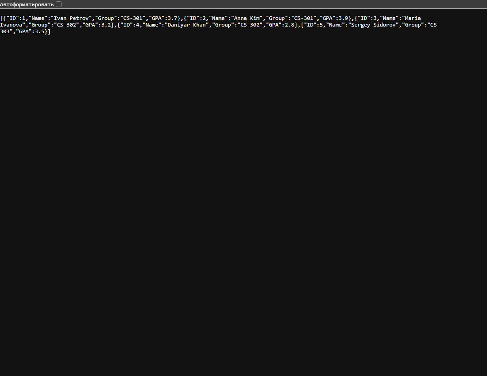

# Практическая работа 12 — справочник студентов

## Краткий отчёт

Справочник студентов с поиском по ID, группе и минимальному GPA.

## Выполнение по заданию

### 1. Данные

Структура `Student` содержит ID, имя, группу и GPA. В памяти находятся пять студентов.

### 2. Маршруты

`GET /students`, `GET /students/{id}`, `GET /students/group/{group}`, `GET /students?minGPA=3.5`.

### 3. Проверка

Проверены список, группа CS-301, фильтр GPA, ошибки 400 и 404.

## Запуск

```powershell
go run .
```

Открыть `http://localhost:8080` и нужные адреса. Остановка — Ctrl+C. POST и DELETE можно выполнить через Postman или `curl.exe`. Данные хранятся до завершения программы.

## Скриншот выполнения



## Вывод

ServeMux направляет запросы в отдельные функции. Параметры пути и строки запроса используются для поиска.
